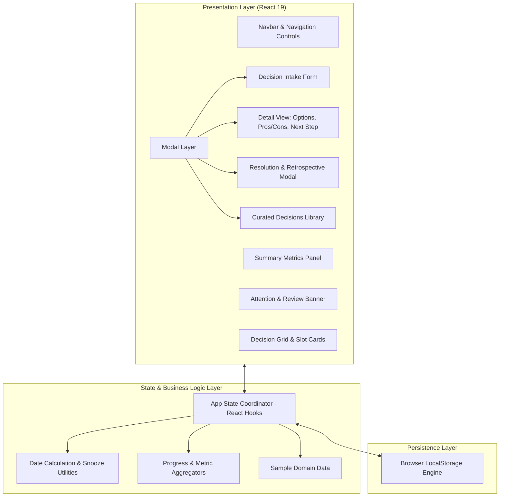
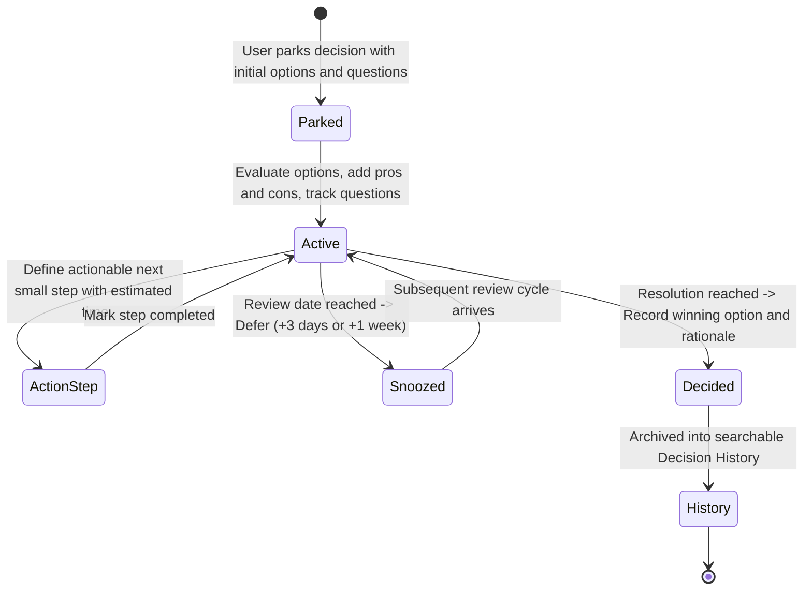

# Decision Parking Lot

> A structured cognitive offloading framework and web application designed to reduce decision fatigue through timed deferral, discrete option evaluation, and actionable next steps.

---

## Overview

Decision Parking Lot is a focused, client-side web application built to combat mental fatigue and overthinking. Rather than keeping complex or unresolved dilemmas continuously active in working memory, the application allows users to park decisions into structured, numbered slots with designated review dates.

The platform provides a systematic environment to:
- Deconstruct ambiguous challenges into concrete, distinct options.
- Systematically record and weigh pros and cons for each option.
- Define a single, low-friction "Next Small Step" to maintain momentum without feeling overwhelmed.
- Track open questions and monitor resolution readiness.
- Defer evaluations using calibrated review dates and quick snooze actions.
- Document selected outcomes and final rationale within an archived decision history.

---

## Architecture and System Design

### Architecture Overview

The application follows a unidirectional, local-first React architecture. Application state is coordinated at the root level and synchronized with the browser's storage engine, ensuring data persistence with zero network latency and complete user privacy.



### Component Hierarchy

```text
App (Root Coordinator)
│
├── Navbar
│   ├── Brand Identifier
│   ├── Navigation Tabs (Dashboard / History)
│   └── Action: Park a Decision
│
├── Dashboard View
│   ├── Page Header & Subtitle
│   ├── StatsSummary (Active Slots, Due for Review, Decided Count)
│   ├── AttentionBanner (Conditional: Overdue or Due Today)
│   ├── Filter & Search Controls (Category Chips, Search Input)
│   └── DecisionGrid
│       └── DecisionCard (Slot ID, Tags, Review Pill, Next Step, Progress Bar)
│
├── History View
│   ├── Search & Filter Bar
│   └── History Card List (Chosen Option, Decision Rationale, Completion Date)
│
└── Modals & Overlays
    ├── DecisionForm (Creation & Validation)
    ├── DecisionDetails (Options, Pros/Cons Manager, Checklist, Next Step Manager)
    ├── DecideModal (Final Choice Selection & Retrospective Input)
    └── ExploreSamplesModal (Domain Templates Loader)
```

### Decision Lifecycle

The diagram below outlines the state transitions a parked decision undergoes from initial capture to final archival:



---

## Core Capabilities

### Structured Cognitive Offloading
- Sequential parking slot indexing (`#01`, `#02`, etc.) reinforcing the mental model of dedicated mental space.
- Categorization across six standard domains: Career, Academics, Finance, Personal, Lifestyle, and Technology.
- Search and categorical filter system for immediate retrieval.

### Multi-Option Analysis and Trade-Off Evaluation
- Decomposition of ambiguous problems into multiple distinct choices.
- Interactive Pros and Cons management per option, providing visual parity between upside and risk.

### Actionable Next Steps
- Definition of a single, immediate micro-action with estimated completion time (e.g., 15 minutes) to bypass analysis paralysis.
- Built-in status tracking to complete, record, and replace steps incrementally.

### Timed Deferral and Smart Review Cycles
- Automated review tracking based on system calendar calculations.
- Prominent attention banner alerting users when decisions become due or overdue.
- Quick snooze shortcuts (`+3d`, `+1w`) to recalculate target dates with zero friction.

### Question Tracking and Readiness Progress
- Unanswered questions checklist embedded within each decision.
- Real-time animated progress indicator reflecting the percentage of resolved inquiries.

### Resolution and Retrospective History
- Formalized "Mark as Decided" flow requiring explicit selection of the chosen alternative and documented rationale.
- Dedicated History view preserving past decisions, rationale, and timestamps for post-decision audits and reflection.

### Editorial Visual Design and Accessibility
- Editorial typography pairing: Lora serif for headers, Inter sans-serif for UI clarity, and JetBrains Mono for metrics and slot markers.
- Restrained color palette using warm ivory backgrounds, deep ink text, subtle borders, and an indigo focus accent.
- Responsive CSS Grid utilizing `minmax(0, 1fr)` tracks to prevent card clipping or column overflow across all screen sizes.
- Full support for keyboard navigation (`:focus-visible`) and user-preferred motion constraints (`prefers-reduced-motion: reduce`).

---

## Technical Specifications

| Layer | Technology | Details |
| :--- | :--- | :--- |
| Framework | React 19.2 | Functional components, custom event callbacks, React Hooks |
| Build Tool | Vite 8.3 | Hot Module Replacement (HMR), tree-shaken production bundles |
| Styling | Pure CSS3 | Custom property design tokens, CSS Grid, Flexbox, responsive breakpoints |
| Icons | Lucide React | Lightweight SVG iconography |
| Linter | Oxlint | Static analysis and code quality verification |
| Persistence | Web Storage API | Synchronous client-side persistence via `localStorage` |

---

## Project Structure

```text
decision-parking-lot/
├── public/
│   ├── favicon.svg             # Application favicon
│   └── icons.svg               # SVG icon definitions
├── src/
│   ├── assets/                 # Vector illustrations and static assets
│   ├── components/
│   │   ├── AttentionBanner.jsx # Due and overdue decision alerts
│   │   ├── DecideModal.jsx     # Resolution and retrospective entry form
│   │   ├── DecisionCard.jsx    # Individual slot card component
│   │   ├── DecisionDetails.jsx # Full detail view: options, pros/cons, next step
│   │   ├── DecisionForm.jsx    # Modal form for parking new decisions
│   │   ├── EmptyState.jsx      # Fallback display for empty datasets
│   │   ├── ExploreSamplesModal.jsx # Curated scenario templates
│   │   ├── HistoryView.jsx     # Archive of resolved decisions
│   │   ├── Navbar.jsx          # Header navigation and primary action button
│   │   ├── ProgressBar.jsx     # Dynamic question completion progress bar
│   │   └── StatsSummary.jsx    # Active, due, and decided counters
│   ├── data/
│   │   └── sampleData.js       # Initial seed decisions representing student & early career dilemmas
│   ├── utils/
│   │   ├── dateUtils.js        # Relative dates, date formatting, and snooze computation
│   │   └── decisionUtils.js    # Metric aggregators and filtering helpers
│   ├── App.jsx                 # Application controller and view router
│   ├── index.css               # Design system tokens, responsive grid, and UI styles
│   └── main.jsx                # DOM mount entry point
├── .gitignore
├── .oxlintrc.json
├── LICENSE                     # MIT License
├── package.json
├── vite.config.js
└── README.md
```

---

## Getting Started

### Prerequisites

- Node.js (version 18 or higher recommended)
- npm, pnpm, or yarn

### Installation

1. Clone the repository:
   ```bash
   git clone https://github.com/Mona-Agrawall/decision-parking-lot.git
   cd decision-parking-lot
   ```

2. Install dependencies:
   ```bash
   npm install
   ```

3. Launch the development server:
   ```bash
   npm run dev
   ```
   Navigate to `http://localhost:5173` in your browser.

4. Generate production build:
   ```bash
   npm run build
   ```

5. Run static lint checks:
   ```bash
   npm run lint
   ```

---

## License

This project is open-source software licensed under the [MIT License](LICENSE).
